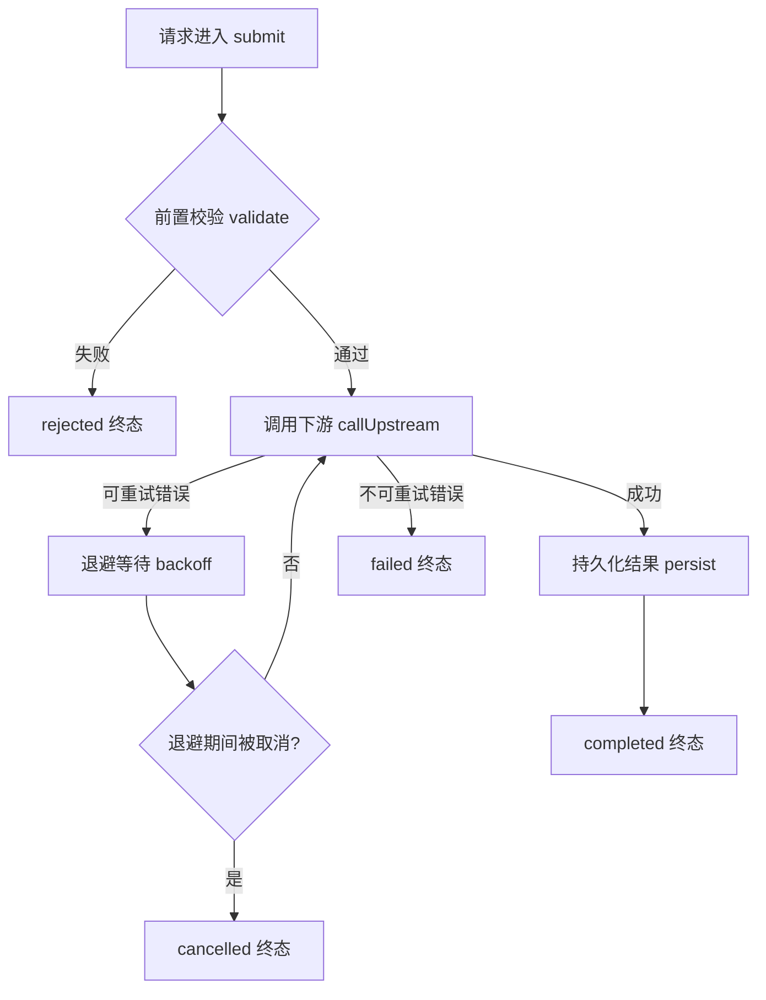

# 五件套模板与好坏示例

每件给出：结构模板 + 一个坏例子 + 一个好例子。好坏对比比抽象规则更容易模仿。

---

## 1. FLOW.md — 流程图

**画什么**：不是「有哪些类」的静态结构，而是「一个输入进来以后，经过哪些步骤，产生哪些状态和副作用」。

**必须覆盖**：

- 主流程（happy path）；
- 主要异常与恢复路径（重试、降级、取消、超时）；
- 状态切换与终态（什么状态算结束，迟到事件会不会覆盖终态）；
- 关键节点标注对应的入口函数 / 状态定义 / 模块，让图能定位回代码。

**Mermaid 骨架**（组件复杂时按子流程拆多张图）：



**防过时三原则**：

1. 保留关键行为，不逐行翻译代码——图是模型，不是代码的镜像；
2. 行为改变时更新；纯内部重构（行为不变）不需要改图；
3. 图与代码不一致时，先核实哪边对，不要照图强改代码。

---

## 2. DECISIONS.md — 架构与选型说明

**它防什么**：AI 看到「老协议、同步调用、不够优雅的接口」，很容易判定为技术债。决策文档保存「看起来落后 ≠ 应该被替换」的证据。

### 条目模板

```markdown
## D-003：当前保留同步处理路径

背景：
这条路径影响用户可感知的响应延迟。

选择：
在关键路径内同步完成处理。

考虑过的替代方案：
异步队列处理。

权衡：
牺牲部分解耦与调度灵活性，换取更直接的延迟控制。

证据：
- 性能测试报告（链接 / 路径）
- 需求讨论记录（链接）

重新评估条件：
延迟目标改变，或新的异步实现证明可满足同一目标。

状态：生效中 | 已失效（由 D-007 取代）
```

### 坏例子

> 使用同步方案，因为性能更好。

无法指导任何未来修改——不知道性能指什么、替代方案是否考虑过、什么情况下可以推翻。

### 好例子

见上面 D-003。关键差异：有背景、有被否决的替代方案、**有重新评估条件**。

### 失效处理

决策被推翻时**标记失效并指向新决策**，不要删除条目。失效的决策本身就是修改历史的一部分。

### 边界提醒

决策文档是护栏不是权限系统。合理行为是「这个请求与现有约束冲突，我先说明影响再确认」，而不是文档写过一次就永远拒绝用户修改。

---

## 3. HISTORY.md — 修改历史

**这里是把 git 历史整理成可读的演变记录，不是改写提交历史，也不是复制 git log。**

与 DECISIONS 的分工：DECISIONS 写「现在仍然有效的决策」，HISTORY 写「过去发生过什么、为什么走到现在」。两者互相链接，不重复整段内容。

**优先记录**（不需要记录所有提交）：

- 架构方向变化（异步 ↔ 同步、单体 ↔ 拆分）；
- 协议与接口兼容性变化；
- 故障及其修复；
- 曾经尝试、后来回退的方案；
- 看起来奇怪但刻意保留的行为;
- 外部依赖升级引发的特殊处理。

### 条目模板

```markdown
## H-007：撤回自动重试

变化：
该操作不再自动重试。

原因（证据等级 B）：
对端可能已完成操作但响应在网络中丢失；
重新请求会产生重复副作用。

关联：
修复提交 a1b2c3d、故障记录（链接）。

当前影响：
恢复自动重试前，需要先解决幂等性问题。
```

### 证据分级（防编造动机）

git 能告诉你「改了什么」，不一定能告诉你「为什么改」。每条原因标注来源：

- **A**：有 PR / issue / 事故记录支持；
- **B**：维护者口述确认；
- **C**：根据代码变化推测（**必须显式标注，等待升级**）。

推测被写进知识库不会自动变成事实。bootstrap 结束时把所有 C 级条目列出来请维护者逐条确认。

---

## 4. TODO.md — 待办事项

**定位**：保存未完成的判断，管理 agent 的探索边界。**待办是背景，不是本次任务的授权清单**——skill 使用者（agent）看到待办不得顺手执行。

### 条目模板

```markdown
## T-012：评估重试退避期间的取消响应

状态：候选未验证   # 已确认待处理 | 候选未验证 | 等待决策 | 有意暂缓

问题：
取消可能要等当前退避结束才生效，尚未确认。

影响：
长退避场景下取消延迟可达数秒。

下一步：
先构造可控测试，再决定是否修改等待机制。

完成条件：
给出可复现结果；若修改，补充取消行为回归测试。
```

每条至少包含：问题及证据、影响、状态、下一步、完成条件。

**与 issue 系统的关系**：项目已有 issue 跟踪时，本地只保留摘要与链接，避免出现两份互相矛盾的待办清单。

---

## 5. SCENARIOS.md — 自然语言测试案例库

**理念**：以前构造端到端测试环境太费事；现在 agent 可以根据文字案例准备环境、执行验证。但要记住：**自然语言案例驱动测试，不能仅凭一段描述就获得自动化测试的确定性。**

### 坏例子

> 取消后不应该继续执行。

没说取消时任务处于什么阶段、已发出的请求能不能撤回、怎么观察、终态是什么。

### 好例子

```markdown
## S-003：退避等待期间取消任务

前置：
使用本地 mock 模型服务。
首次请求返回可重试错误，任务进入退避等待。

动作：
在退避结束前取消任务。

预期：
1. 任务进入 cancelled 终态。
2. 不再发起新的模型请求。
3. 终态事件只记录一次。

验证：
检查任务状态、mock 服务请求次数和事件记录。
```

关键差异：前置 / 动作 / 预期 / 验证四段齐全，预期是可观察的断言。

### 执行者（agent）的行为规范

可以：理解案例 → 准备隔离环境 → 创建 mock / 夹具 → 执行动作 → 检查明确预期 → 留下运行证据。

不可以：只读代码之后说「逻辑上应该通过」。

结果必须三态：已执行且通过 | 已执行但失败 | 环境不满足未执行。

### 与测试代码的关系

- 探索性验收：自然语言案例很好用；
- 新发现的边界：先用文字明确，再让 agent 实现测试；
- 稳定、关键的回归：尽量固化为可重复运行的自动化测试。

**文字保存意图，测试代码保存可重复的执行与断言，两者互补。**
